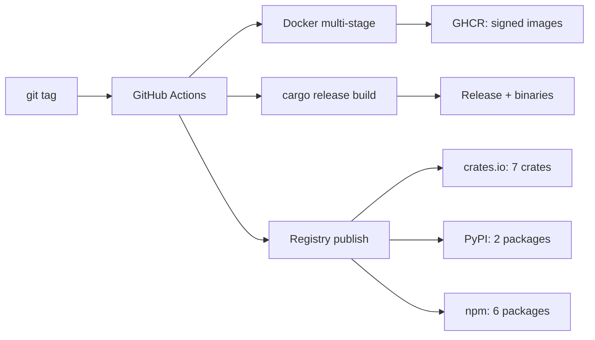

<picture>
  <source media="(prefers-color-scheme: dark)" srcset="https://raw.githubusercontent.com/BartoszOsiej/BartoszOsiej/stats/svg/banner-dark.svg" />
  
</picture>

<div align="center">

<picture>
  <source media="(prefers-color-scheme: dark)" srcset="https://raw.githubusercontent.com/BartoszOsiej/BartoszOsiej/stats/svg/typing-dark.svg" />
  
</picture>

[](https://github.com/Hartwell-Labs)
[](https://bartoszosiej.github.io/Portfolio/)
[](https://bartoszosiej.github.io/thethreadcalls/)
[](https://dev.to/bartoszosiej)
[](https://bartoszosiej.github.io/writing/)
[](mailto:mmc29213@gmail.com)
[](https://www.linkedin.com/in/bartoszosiej2007/)
[](https://t.me/hartwell_info)

</div>

<picture>
  <source media="(prefers-color-scheme: dark)" srcset="https://raw.githubusercontent.com/BartoszOsiej/BartoszOsiej/stats/svg/terminal-dark.svg" />
  
</picture>

> [!IMPORTANT]
> **Founder & CEO of [Hartwell Labs](https://github.com/Hartwell-Labs)** — independent engineering lab: eBPF security systems, programming languages and tools, all open source (MIT).
> **19 y/o · Poland · open to first paid role** — remote/hybrid, junior systems/backend. My article on eBPF ransomware detection is **accepted on LinuxSecurity** (publication Sep 22–26) — technical writing samples on request. Author of [*The Stitcher Trilogy*](https://bartoszosiej.github.io/thethreadcalls/) (crime horror).
> **Now (Oct 2026):** [TrustNode](https://github.com/BartoszOsiej/trustnode) — a Solana-like validator built from scratch in Rust (PoH clock, Tower BFT, Sealevel parallel execution, Turbine erasure coding, CRDS gossip); [Externum on DevHunt](https://devhunt.org/tool/externum); new: [Talus Field Guide](https://hartwell-labs.pl/talus-process-monitor/field-guide.html) — deployment & tuning playbook.
> Everything below is *deployed infrastructure*, not tutorials: **25 original repositories** here (+13 under the [Hartwell Labs org](https://github.com/Hartwell-Labs)) — every active one with CI/CD, releases with binaries, Docker images and published packages. 3 PRs open upstream in aya-rs/book.

---

## ⚙️ Stack

<picture>
  <source media="(prefers-color-scheme: dark)" srcset="https://raw.githubusercontent.com/BartoszOsiej/BartoszOsiej/stats/svg/rule-dark.svg" />
  
</picture>

<div align="center">

[](https://www.rust-lang.org/)
[](https://aya-rs.dev/)
[](https://www.python.org/)
[](https://www.typescriptlang.org/)
[](https://fastapi.tiangolo.com/)
[](https://wgpu.rs/)
[](https://github.com/features/packages)
[](https://github.com/features/actions)

</div>

---

## 🚀 Flagship Projects

<picture>
  <source media="(prefers-color-scheme: dark)" srcset="https://raw.githubusercontent.com/BartoszOsiej/BartoszOsiej/stats/svg/rule-dark.svg" />
  
</picture>

<table>
<tr><td valign="top" width="50%">

### 🔬 [Talus](https://github.com/BartoszOsiej/talus-process-monitor)

eBPF endpoint security agent — kernel-level `execve`/`openat`/`connect` tracing through Aya, per-CPU perf buffers, sliding-window alerting, automated `SIGKILL` response, full FrankenTUI.

`Rust` `Aya` `FrankenTUI` `eBPF`

[](https://crates.io/crates/process-monitor) [](https://github.com/BartoszOsiej/talus-process-monitor/pkgs/container/talus-process-monitor) [](https://github.com/BartoszOsiej/talus-process-monitor/releases)

</td><td valign="top" width="50%">

### 🧬 [TrustNode](https://github.com/BartoszOsiej/trustnode) — *a validator, from scratch*

Solana-like validator built in Rust: proof-of-history clock with **real sequential PoH verification**, Tower BFT fork choice, Sealevel-style parallel execution, Turbine erasure coding, CRDS gossip and JSON-RPC. **228-test suite**, MIT.

`Rust` `Consensus` `PoH` `Sealevel` `Turbine`

[](https://github.com/BartoszOsiej/trustnode/actions) [](https://github.com/BartoszOsiej/trustnode) [](https://github.com/BartoszOsiej/trustnode/blob/master/LICENSE)

</td></tr>
<tr><td valign="top" width="50%">

### 🎮 [NV2_ENGINE](https://github.com/BartoszOsiej/NV2_ENGINE) — *VIVIA*

Voxel survival engine with NASA POWER real-climate worlds and an embedded MeMLP neural network. EGS submission kit ready — published as `nv2_engine` on crates.io.

**▶ [Landing page](https://bartoszosiej.github.io/NV2_ENGINE/)**

`Rust` `wgpu` `MeMLP` `NASA-climate`

[](https://crates.io/crates/nv2_engine) [](https://github.com/BartoszOsiej/NV2_ENGINE/pkgs/container/nv2_engine) [](https://github.com/BartoszOsiej/NV2_ENGINE/releases)

</td><td valign="top" width="50%">

### ⚡ [externum](https://github.com/BartoszOsiej/externum)

Programming language built from scratch — compiles to Python, Bash and native binary. Ownership, traits, macros. **382-test suite**, on PyPI since v2.

**▶ [Run it in your browser — and extend the language live](https://hartwell-labs.pl/externum/)**

`Python` `Compiler design` `PyPI`

[](https://pypi.org/project/externum/) [](https://github.com/BartoszOsiej/externum/pkgs/container/externum) [](https://hartwell-labs.pl/externum/)

</td></tr>
<tr><td valign="top" width="50%">

### 🔒 [CyberForge](https://github.com/BartoszOsiej/CyberForge)

Four security tools as one workspace — port scanner, web scanner, hash cracker, packet analyzer. Each shipped separately on crates.io.

`Rust` `Tokio` `libpcap`

[](https://crates.io/crates/netrecon) [](https://crates.io/crates/shadowscan) [](https://crates.io/crates/hashsleuth) [](https://crates.io/crates/packeteye)

</td><td valign="top" width="50%">

### 🛡️ [QuantumShield](https://github.com/BartoszOsiej/pqguard)

Post-quantum file encryption CLI — ML-KEM-768 key exchange + AES-256-GCM + HKDF. NIST FIPS 203 compliant, fuzz-tested.

**▶ [Landing page](https://hartwell-labs.pl/quantum-shield/)**

`Rust` `Cryptography` `NIST`

[](https://crates.io/crates/pqguard) [](https://github.com/BartoszOsiej/pqguard/actions) [](https://github.com/BartoszOsiej/pqguard/pkgs/container/pqguard)

</td></tr>
<tr><td valign="top" width="50%">

### 🪙 [pqbit](https://github.com/BartoszOsiej/pqbit)

**Post-quantum Bitcoin from genesis** — fair-launch UTXO chain with *only* NIST PQ signatures (ML-DSA-44 / SLH-DSA, FIPS 204/205), no ECDSA ever. Gossiping p2p network, PQ-validated mempool, continuous mining. Genesis parameters in public review; grant application filed (NGI Zero / NLnet, decision Nov 2026).

**▶ [Landing](https://bartoszosiej.github.io/pqbit/)** · **▶ [GENESIS.md — open review](https://github.com/BartoszOsiej/pqbit/blob/master/GENESIS.md)**

`Rust` `Post-quantum` `Bitcoin research` `p2p`

[](https://github.com/BartoszOsiej/pqbit/actions) [](https://github.com/BartoszOsiej/pqbit) [](https://bartoszosiej.github.io/pqbit/)

</td><td valign="top" width="50%">

### 📚 [Docs](https://bartoszosiej.github.io/Docs/)

Technical documentation site — architecture guides, API reference, deployment playbooks, and the product field guides.

`TypeScript` `Deploy` `GitHub Pages`

[](https://www.npmjs.com/package/bartosz-osiej-docs) [](https://bartoszosiej.github.io/Docs/)

</td></tr>
</table>

---

## 📝 Technical Writing

<picture>
  <source media="(prefers-color-scheme: dark)" srcset="https://raw.githubusercontent.com/BartoszOsiej/BartoszOsiej/stats/svg/rule-dark.svg" />
  
</picture>

Publiczne artykuły o tym, jak działają rzeczy na niskim poziomie — z kodem, nie z marketingiem.

- **[Detecting ransomware with eBPF in Rust](https://bartoszosiej.github.io/content/ebpf-ransomware-everything)** *(2026-09-16)* — tutorial: tracepointy `execve`/`openat`, per-CPU perf buffers, sliding-window detection, automated SIGKILL. Kod źródłowy: talus-process-monitor.
- **[Catching ransomware with eBPF: what execve/openat tracing taught me about false positives](https://bartoszosiej.github.io/content/ebpf-ransomware-monitor-lessons)** *(2026-09-13)* — deep-dive: behavioral tracing, scoring without false positives, lessons from production-grade builds.

*Writing for: Draft.dev · Corellium · Honeybadger · Mattermost · Vultr · Semaphore · SigNoz · Edge Network.* → [wszystkie writing samples](https://bartoszosiej.github.io/writing/)

---

<details>
<summary><b>📦 More projects (click to expand)</b></summary>

| | Project | What it is | Try it |
|---|---------|-----------|--------|
| 🔐 | [**Fortis**](https://github.com/BartoszOsiej/riscv-trust) | Bare-metal RISC-V measured boot — SHA-256 + ML-KEM-768 chain of trust | QEMU |
| ◈ | [**Aurora**](https://github.com/BartoszOsiej/Aurora) | Complete OS in the browser — kernel, window manager, filesystem, 8 apps, procedural audio | [npm](https://www.npmjs.com/package/aurora-os) |
| 🌐 | [**Meshcore**](https://github.com/BartoszOsiej/Meshcore) | Serverless P2P chat — WebRTC + MQTT signaling, zero dependencies | [npm](https://www.npmjs.com/package/n2-mesh) |
| 🔗 | [**Shortlink**](https://github.com/BartoszOsiej/Shortlink) | URL shortener — JWT auth, click tracking, React dashboard | [PyPI](https://pypi.org/project/fastapi-url/) |
| 🎯 | [**Promptbox**](https://github.com/BartoszOsiej/Promptbox) | Remote prompt inbox for AI agents — mobile-first, zero backend | [npm](https://www.npmjs.com/package/prompt-inbox) |
| 🎮 | [**Forge**](https://github.com/BartoszOsiej/Factorio-web-game) | Factory builder playable in browser — own codebase inspired by Factorio, 50+ commits of original systems | [npm](https://www.npmjs.com/package/novactorio) |
| 📚 | [**TeleWiedza**](https://github.com/BartoszOsiej/TeleWiedza) | PL/EN telecom encyclopedia — networking, 5G, fiber, security | [docs](https://bartoszosiej.github.io/Docs/) |

</details>

---

## 📦 Distribution — everything ships, nothing rots

<picture>
  <source media="(prefers-color-scheme: dark)" srcset="https://raw.githubusercontent.com/BartoszOsiej/BartoszOsiej/stats/svg/rule-dark.svg" />
  
</picture>

<picture>
  <source media="(prefers-color-scheme: dark)" srcset="https://raw.githubusercontent.com/BartoszOsiej/BartoszOsiej/stats/svg/pipeline-dark.svg" />
  
</picture>



<div align="center">

| 🐳 GHCR images | 🦀 crates.io | 🐍 PyPI | 🟢 npm | 📦 Public repos |
|:--------------:|:------------:|:-------:|:------:|:----------------------:|
| **signed & live** | **7** | **2** | **6** | **24 (21 own)** |

</div>

### 🕹️ Interactive — a recruiter can actually run this

| | |
|---|---|
| **▶ [Externum Playground](https://hartwell-labs.pl/externum/)** | The programming language running 100% in your browser (Pyodide). Write programs, hot-load your own modules into the live runtime, compile to Python/Bash/binary. Sessions shareable by URL. |
| **🧬 `/define`** | Comment on an issue → the bot validates your module against Externum's type checker → opens a PR into the stdlib → once merged, `import` works for everyone including the web playground. [The language evolves from comments.](https://github.com/BartoszOsiej/externum/issues/7) |
| **🎮 `/run`** | [Comment on cybersec-tools](https://github.com/BartoszOsiej/CyberForge/issues/10) → the bot builds the workspace in CI and executes the real binaries with sandboxed guardrails, posting output back. |
| **🔏 `./verify.sh v0.4.5`** | One command verifies SLSA provenance + Sigstore signatures + SBOM of any release. No trust required. |

### ⚡ One-command install — like real CLI tools

```bash
# macOS (Apple Silicon & Intel)
brew tap bartoszosiej/tap https://github.com/BartoszOsiej/homebrew-tap
brew install bartoszosiej/tap/netrecon bartoszosiej/tap/hashsleuth

# Windows
scoop bucket add bartoszosiej https://github.com/BartoszOsiej/scoop-bucket
scoop install netrecon hashsleuth
```

*Formulas & manifests are re-synced hourly by a bot with fresh SHA-256 sums — never stale.*

### 🖥️ Build matrix — 5 platforms per release

<div align="center">

| Linux x86_64 | Linux arm64 | macOS arm64 | macOS x86_64 | Windows x64 |
|:------------:|:-----------:|:-----------:|:------------:|:-----------:|
| ✅ | ✅ | ✅ | ✅ | ✅ |

</div>

---

## 🔐 Signed supply chain

<picture>
  <source media="(prefers-color-scheme: dark)" srcset="https://raw.githubusercontent.com/BartoszOsiej/BartoszOsiej/stats/svg/rule-dark.svg" />
  
</picture>

*The same pipeline discipline big tech uses — cryptographically verifiable, not "trust me".*

<div align="center">

[](https://github.com/BartoszOsiej/BartoszOsiej/blob/main/LICENSE)

</div>

| Layer | What it means |
|---|---|
| **cosign keyless signing** | Every GHCR image is signed via Sigstore/Fulcio OIDC — no keys to leak, identity bound to the GitHub workflow |
| **SLSA v1 provenance** | Every release binary carries a build attestation proving *which commit, which runner, which pipeline* produced it |
| **SPDX SBOM** | Every release ships a machine-readable software bill of materials |

Verify it yourself — no trust required:

```bash
# verify a container image signature
cosign verify ghcr.io/bartoszosiej/cybersec-tools \
  --certificate-identity-regexp "^https://github.com/BartoszOsiej/" \
  --certificate-oidc-issuer https://token.actions.githubusercontent.com

# verify binary build provenance
gh attestation verify netrecon-x86_64-unknown-linux-gnu \
  -R BartoszOsiej/CyberForge
```

---

<details>
<summary><b>🗂️ Full package index</b></summary>

**npm**
[](https://www.npmjs.com/package/aurora-os)
[](https://www.npmjs.com/package/n2-mesh)
[](https://www.npmjs.com/package/novactorio)
[](https://www.npmjs.com/package/prompt-inbox)
[](https://www.npmjs.com/package/bartosz-osiej-docs)
[](https://www.npmjs.com/package/bartosz-osiej-portfolio)

**crates.io**
[](https://crates.io/crates/process-monitor)
[](https://crates.io/crates/pqguard)
[](https://crates.io/crates/nv2_engine)
[](https://crates.io/crates/netrecon)
[](https://crates.io/crates/shadowscan)
[](https://crates.io/crates/hashsleuth)
[](https://crates.io/crates/packeteye)

**PyPI**
[](https://pypi.org/project/externum/)
[](https://pypi.org/project/fastapi-url/)

</details>

---

## 🛡️ Engineering discipline

<picture>
  <source media="(prefers-color-scheme: dark)" srcset="https://raw.githubusercontent.com/BartoszOsiej/BartoszOsiej/stats/svg/rule-dark.svg" />
  
</picture>

> [!NOTE]
> Every repository runs the same production-grade pipeline — this is how I work, not how I pretend to work.

| Practice | Coverage |
|----------|:--------:|
| CodeQL security scanning | ✅ every active repo |
| Dependabot + vulnerability alerts | ✅ every active repo |
| Branch protection + squash-merge history | ✅ every active repo |
| Public sprint boards + milestones | ✅ 6 boards |
| Discussions, CONTRIBUTING, SECURITY, CoC | ✅ every active repo |
| MIT licensing, topics, descriptions | ✅ every active repo |

---

## 📊 Live Package Metrics

<picture>
  <source media="(prefers-color-scheme: dark)" srcset="https://raw.githubusercontent.com/BartoszOsiej/BartoszOsiej/stats/svg/rule-dark.svg" />
  
</picture>

*Self-hosted stats engine — a scheduled workflow queries npm / PyPI / crates.io /
GitHub releases and renders these cards from scratch. No badge services, no
third-party renderers: every pixel comes from my own pipeline.*

<picture>
  <source media="(prefers-color-scheme: dark)" srcset="https://raw.githubusercontent.com/BartoszOsiej/BartoszOsiej/stats/svg/dashboard-dark.svg" />
  
</picture>

<picture>
  <source media="(prefers-color-scheme: dark)" srcset="https://raw.githubusercontent.com/BartoszOsiej/BartoszOsiej/stats/svg/metrics-dark.svg" />
  
</picture>

### 🏆 Trophy case

*Hand-forged achievements. GitHub does not issue these and none of them are embeddable — every medal below is an animated SVG minted by my own pipeline, refreshed on a schedule.*

<picture>
  <source media="(prefers-color-scheme: dark)" srcset="https://raw.githubusercontent.com/BartoszOsiej/BartoszOsiej/stats/svg/achievements-dark.svg" />
  
</picture>

---

## 📈 GitHub Stats

<picture>
  <source media="(prefers-color-scheme: dark)" srcset="https://raw.githubusercontent.com/BartoszOsiej/BartoszOsiej/stats/svg/rule-dark.svg" />
  
</picture>

<picture>
  <source media="(prefers-color-scheme: dark)" srcset="https://raw.githubusercontent.com/BartoszOsiej/BartoszOsiej/stats/svg/stats-dark.svg" />
  
</picture>
<picture>
  <source media="(prefers-color-scheme: dark)" srcset="https://raw.githubusercontent.com/BartoszOsiej/BartoszOsiej/stats/svg/langs-dark.svg" />
  
</picture>

<picture>
  <source media="(prefers-color-scheme: dark)" srcset="https://raw.githubusercontent.com/BartoszOsiej/BartoszOsiej/stats/svg/streak-dark.svg" />
  
</picture>

<picture>
  <source media="(prefers-color-scheme: dark)" srcset="https://raw.githubusercontent.com/BartoszOsiej/BartoszOsiej/stats/svg/heatmap-dark.svg" />
  
</picture>

<picture>
  <source media="(prefers-color-scheme: dark)" srcset="https://raw.githubusercontent.com/BartoszOsiej/BartoszOsiej/stats/svg/stars-dark.svg" />
  
</picture>

<picture>
  <source media="(prefers-color-scheme: dark)" srcset="https://raw.githubusercontent.com/BartoszOsiej/BartoszOsiej/profile-3d/profile-night-rainbow.svg" />
  
</picture>

---

## 🗺️ Timeline

<picture>
  <source media="(prefers-color-scheme: dark)" srcset="https://raw.githubusercontent.com/BartoszOsiej/BartoszOsiej/stats/svg/rule-dark.svg" />
  
</picture>

```
2021 ──► first lines of code — Java, CryEngine, Minecraft mechanics (@ghost0development)
2025 ──► networking & security track (teleinformatyka)
2026 Q1 ──► Rust deep dive: voxel engine, eBPF kernel probes, compiler from scratch
2026 Q2 ──► production CI/CD: Actions → GHCR → crates.io / PyPI / npm, 14 packages live
2026 Q3 ──► ecosystem upgrade: aya 0.14, ureq 3, ml-kem 0.3, dashmap 6, RISC-V bare-metal (Fortis)
2026 Q4 ──► upstream PRs to aya-rs merged, first paid role 🎯
```

---

## 🤝 Upstream Contributions

<picture>
  <source media="(prefers-color-scheme: dark)" srcset="https://raw.githubusercontent.com/BartoszOsiej/BartoszOsiej/stats/svg/rule-dark.svg" />
  
</picture>

| Target | PR type | Status |
|--------|---------|--------|
| [aya-rs/book](https://github.com/aya-rs/book) | Fix outdated `offset_of!` tip in Parsing Packets page (issue #202) | [PR open](https://github.com/aya-rs/book/pulls?q=is%3Apr+author%3ABartoszOsiej) |
| [aya-rs/book](https://github.com/aya-rs/book) | Add typos spellcheck CI (issue #91) | [PR open](https://github.com/aya-rs/book/pulls?q=is%3Apr+author%3ABartoszOsiej) |
| [aya-rs/book](https://github.com/aya-rs/book) | Update deprecated `aya::Bpf` references + MAP API note (issue #73) | [PR open](https://github.com/aya-rs/book/pulls?q=is%3Apr+author%3ABartoszOsiej) |

> All PRs based on real-world experience upgrading talus-process-monitor to aya 0.14.

---

## ✍️ Guestbook

<picture>
  <source media="(prefers-color-scheme: dark)" srcset="https://raw.githubusercontent.com/BartoszOsiej/BartoszOsiej/stats/svg/rule-dark.svg" />
  
</picture>

*No giscus, no Disqus, no third-party embed — GitHub strips `<script>` from READMEs anyway. A signature is just a GitHub **issue** labelled `guestbook`, rendered into the wall below by my own pipeline. Say hi.*

[](https://github.com/BartoszOsiej/BartoszOsiej/issues/new?labels=guestbook&title=Guestbook+entry)

<picture>
  <source media="(prefers-color-scheme: dark)" srcset="https://raw.githubusercontent.com/BartoszOsiej/BartoszOsiej/stats/svg/guestbook-dark.svg" />
  
</picture>

---

## 🕹️ Flex zone

<picture>
  <source media="(prefers-color-scheme: dark)" srcset="https://raw.githubusercontent.com/BartoszOsiej/BartoszOsiej/stats/svg/rule-dark.svg" />
  
</picture>

<table><tr><td width="248" valign="middle">

<picture>
  <source media="(prefers-color-scheme: dark)" srcset="https://raw.githubusercontent.com/BartoszOsiej/BartoszOsiej/stats/svg/clock-dark.svg" />
  
</picture>

</td><td valign="middle">

*A live clock, an idle screensaver, digital rain — all ticking in your browser with **zero JavaScript**.*

GitHub strips `<script>`, blocks `<iframe>`, and renders none of this natively. Everything you see here is hand-written **SMIL** animation inside SVG files served from my own repo. The clock's hands actually rotate; the box actually bounces; the matrix actually falls. View source — there isn't a single line of JS.

</td></tr></table>

<picture>
  <source media="(prefers-color-scheme: dark)" srcset="https://raw.githubusercontent.com/BartoszOsiej/BartoszOsiej/stats/svg/bounce-dark.svg" />
  
</picture>

<picture>
  <source media="(prefers-color-scheme: dark)" srcset="https://raw.githubusercontent.com/BartoszOsiej/BartoszOsiej/stats/svg/matrix-dark.svg" />
  
</picture>

<picture>
  <source media="(prefers-color-scheme: dark)" srcset="https://raw.githubusercontent.com/BartoszOsiej/BartoszOsiej/stats/svg/equalizer-dark.svg" />
  
</picture>

<table><tr><td width="248" valign="middle">

<picture>
  <source media="(prefers-color-scheme: dark)" srcset="https://raw.githubusercontent.com/BartoszOsiej/BartoszOsiej/stats/svg/radar-dark.svg" />
  
</picture>

</td><td valign="middle">

*Even the arcade keeps shipping: a radar sweep, a spectrum analyzer, and Conway's Game of Life. Every frame is computed in Python, frozen into SMIL, and animated by your browser — no JS, no GIF, no video.*

</td></tr></table>

<picture>
  <source media="(prefers-color-scheme: dark)" srcset="https://raw.githubusercontent.com/BartoszOsiej/BartoszOsiej/stats/svg/life-dark.svg" />
  
</picture>

---

## 🌐 Also here

<picture>
  <source media="(prefers-color-scheme: dark)" srcset="https://raw.githubusercontent.com/BartoszOsiej/BartoszOsiej/stats/svg/rule-dark.svg" />
  
</picture>

- **[`ghost0development`](https://github.com/ghost0development)** — my original account, building since **Feb 2021**: 32 repos of early experiments, game prototypes and the original `halcyon-process-monitor` (ancestor of Talus). Everything archived there is preserved as history — active development happens on this account.

<details>
<summary><b>🗂️ Where the ideas came from (archive → production)</b></summary>

| Archive — @ghost0development (2021–2025) | Production — @BartoszOsiej (2026–) |
|---|---|
| `halcyon-process-monitor` — first eBPF probe | [Talus](https://github.com/BartoszOsiej/talus-process-monitor) — eBPF endpoint security, on crates.io |
| `NV-2.0` / `NV2_ENGINE` — voxel prototypes | [NV2_ENGINE](https://github.com/BartoszOsiej/NV2_ENGINE) — VIVIA engine, on crates.io |
| `Factorio-web-game` / `Factorio-pt` — game experiments | [Forge](https://github.com/BartoszOsiej/Factorio-web-game) — factory builder on npm |
| `FastAPI-url` — first FastAPI service | [Shortlink](https://github.com/BartoszOsiej/Shortlink) — on PyPI as `fastapi-url` |

</details>

---

<picture>
  <source media="(prefers-color-scheme: dark)" srcset="https://raw.githubusercontent.com/BartoszOsiej/BartoszOsiej/stats/svg/divider-dark.svg" />
  
</picture>

<div align="center">

<picture>
  <source media="(prefers-color-scheme: dark)" srcset="https://raw.githubusercontent.com/BartoszOsiej/BartoszOsiej/stats/svg/views-dark.svg">
  
</picture>

*Open to work — [`mmc29213@gmail.com`](mailto:mmc29213@gmail.com)*

**PRODUCTS** — [Talus Enterprise Pack · $50](https://buy.polar.sh/polar_cl_E577BTilme4dnUFsfbG0aE4qo7QILaugmEjsA0oajKK) (eBPF ransomware EDR: deployment guide + support) · [Externum Pro Pack · $29](https://buy.polar.sh/polar_cl_qR2GOfEhXRqlTlPICwyo8XVqKkXjv4mj15cq926Dh1F) (production guide for the language) · [Support Session · $150](https://polar.sh/checkout/polar_c_rGI15C7IzCs54qElT4NJ5aLj7o3p7Uxdj4P4T1OtUsU) (60-min deploy call + written config) — code always MIT & free

</div>
